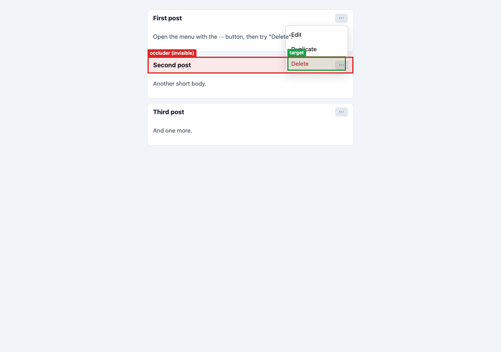
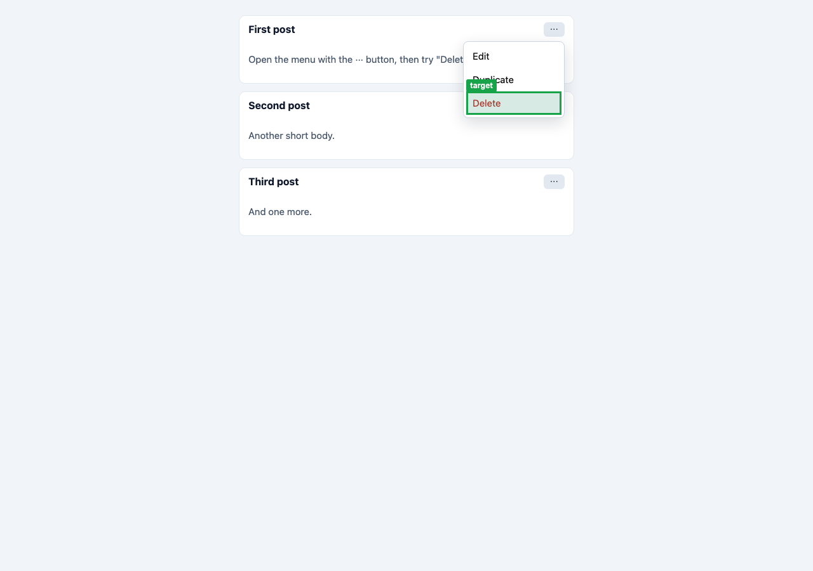

# css-lab-mcp

**Find the invisible element eating your clicks.** A CSS "click doctor" that runs in a real browser
(Playwright + Chromium). Give it a page and the element you can't click, and it tells you what is
actually on top, why it's there (stacking contexts, `z-index`, `pointer-events`, `overflow`, an
invisible overlay), the exact CSS rule responsible (file and line), and the smallest fix.

It's built for AI coding assistants (Claude, Cursor, Copilot, ...). They can call it as an
**MCP server** or a **CLI with `--json`** and get evidence from the rendering engine instead of
guessing `z-index: 9999`.

```
$ css-lab scan http://localhost:5173 --viewport desktop
3 invisible blocker(s) (desktop 1280x900, 1961 points every 24px)
  1. .promo > .carousel-track (div.carousel-track, 1232x122 at 24,24)
     why invisible: paints nothing: transparent background, no border, no shadow, no own text or image
     covers: button#promo-cta
     real click at (60, 60) -> div.carousel-track
     .carousel-track { position: absolute }  app.css:14
     .carousel-track { inset: 0 }  app.css:14
  2. .tile::after ...
  3. .backdrop ...
```

## The problem

"The button is right there, but clicking it does nothing." Usual causes:

- **Invisible blockers.** Something you can't see sits on top: an `opacity: 0` modal backdrop that
  was faded out but never removed, an empty absolutely-positioned wrapper, a "stretched link"
  `::after` with `inset: 0`, a transparent layer from a carousel or animation library.
- **Stacking-context traps.** Your dropdown has `z-index: 1000`, yet the next card paints over it.
  An ancestor created a stacking context, so that `1000` only counts *inside* the ancestor.
- **`pointer-events: none`** inherited from a container, **`overflow: hidden`** clipping, `visibility`,
  `display: none`, or a zero-size box.

DevTools can show you all of this, but only if you already know where to look. AI assistants
can't see the rendered page at all, so they tend to guess. css-lab-mcp checks the page in a real
browser and reports what it finds.

## 30-second demo

The bundled example ([`examples/stacking-bug`](examples/stacking-bug)) is a feed of cards with a
broad rule that gives every card child its own layer:

```css
.card > * { position: relative; z-index: 1; }
```

Open the menu on card #1 and click "Delete":

```bash
npx -p css-lab-mcp css-lab inspect examples/stacking-bug/before.html \
  --selector ".card:nth-child(1) .menu-item.danger" \
  --pre "click:.card:nth-child(1) .menu-toggle" --viewport desktop
```

```
BLOCKED COVERED_BY_SIBLING_STACKING_CONTEXT (desktop 1280x900)
  Clicking button.menu-item.danger[1/3] "Delete" lands on header.card-header[2/3]: the target is
  trapped in header.card-header[1/3]'s stacking context and a sibling layer paints on top.
  Why
    - button.menu-item.danger[1/3] "Delete" is inside div.menu.open (z-index: 1000), which lives in
      the stacking context created by header.card-header[1/3] (position: relative + z-index: 1).
    - A stacking context is a sealed layer: z-index values inside it only order elements within
      header.card-header[1/3]. Against the rest of the page the whole layer paints at its own level.
    - header.card-header[2/3] (position: relative + z-index: 1) is a sibling layer in the same parent
      context (html). Both layers have the same paint level (z-index: 1), so DOM order breaks the
      tie: header.card-header[2/3] comes later in the document and paints on top.
    - The element on top is visually invisible (...): users can see the target, but clicks land
      on header.card-header[2/3].
  Responsible CSS
    .card > * { position: relative }  before.html:15 (<style>) on header.card-header[1/3]
    .card > * { z-index: 1 }  before.html:16 (<style>) on header.card-header[1/3]
    .card > * { z-index: 1 }  before.html:16 (<style>) on header.card-header[2/3]
    .menu { z-index: 1000 }  before.html:24 (<style>) on div.menu.open
  Fix
    1. Raise the layer that contains the target only while it is open: ...
       .card > .card-header:has(.menu.open) {
         z-index: 2;
       }
    2. Or stop creating a layer per child: ... remove z-index: 1 from `.card > *` ...
    3. Or render .card-header > .menu outside the trapping layer: the Popover API or a portal.
  Hit test: 0/9 points reach the target; real click at center -> header.card-header[2/3]
  ! Raising z-index on .card-header > .menu (e.g. 9999) will not help: it cannot escape the
    stacking context of header.card-header[1/3].
```

Run it on [`after.html`](examples/stacking-bug/after.html), which has the suggested fix applied, and
you get `OK` with exit code 0.

| Before (target green, occluder red) | After |
| --- | --- |
|  |  |

These screenshots were made by the tool itself (`--screenshot`). See [`docs/`](docs) for the
invisible-blocker scan screenshot.

## Install

Requires Node.js 20 or newer.

```bash
npm install -g css-lab-mcp      # or use npx, see below
npx playwright install chromium # once, downloads the browser
```

css-lab-mcp depends on `playwright-core`, which doesn't download a browser for you. On launch it tries:

1. `CSS_LAB_CHROMIUM_PATH` (path to any Chrome/Chromium executable), if set;
2. Playwright's Chromium (`npx playwright install chromium`);
3. an installed Google Chrome or Microsoft Edge.

If none of these is found, it prints the install hint. `css-lab install-browser` installs the exact
Chromium build that matches the bundled `playwright-core`.

## CLI

```bash
css-lab scan    <url-or-file> [--viewport desktop,mobile] [--step 24] [--screenshot blockers.png]
css-lab inspect <url-or-file> --selector "<css>" [--viewport desktop,mobile]
                [--pre "click:.menu-toggle" --pre "wait:.menu.open"] [--screenshot out.png] [--json]
css-lab stack   <url-or-file> --x 100 --y 200 [--viewport mobile] [--json]
css-lab rules   <url-or-file> --selector "<css>" [--properties z-index,position | --all] [--pseudo ::after]
css-lab install-browser
```

- **`<url-or-file>`**: `http(s)://` URL (e.g. your dev server) or a local `.html` path.
- **`--viewport`**: `desktop` (1280x900), `mobile` (390x844, touch), `tablet` or `WxH`.
  `inspect` and `scan` default to `desktop,mobile`.
- **`--pre`** (repeatable) gets the page into the state you want to test before inspecting:
  `click:<sel>`, `hover:<sel>`, `focus:<sel>`, `scroll:<sel>`, `wait:<sel>`, `wait:<ms>`, `press:<key>`.
- **`--screenshot`**: for `inspect`, outlines the target in green and the occluder in red. For
  `scan`, outlines each blocker in red (one file per viewport).
- **`--json`** prints machine-readable output (see below).
- **Exit codes**: `0` = clickable or nothing found, `2` = blocked or blockers found, `1` = error.
  You can use them in CI or a pre-commit check.

## MCP setup

The MCP server runs over stdio. Its binary is `css-lab-mcp`.

**Claude Code**

```bash
claude mcp add css-lab -- npx -y css-lab-mcp
```

**Claude Desktop** (`claude_desktop_config.json`) and **Cursor** (`.cursor/mcp.json` or
`~/.cursor/mcp.json`):

```json
{
  "mcpServers": {
    "css-lab": {
      "command": "npx",
      "args": ["-y", "css-lab-mcp"]
    }
  }
}
```

Tools:

| Tool | What it answers |
| --- | --- |
| `scan_invisible_blockers` | Which invisible elements cover visible links, buttons or inputs on this page? |
| `inspect_click_target` | Why can't I click this element? What is on top, why, which rule, and how to fix it. |
| `element_stack_at_point` | Everything under (x, y), topmost first, with stacking-context info. |
| `css_rules_for_element` | Which rules (selector, file, line) set `z-index`/`position`/... on this element, and which one wins. |

All tools accept `preActions` (e.g. `[{"type":"click","selector":".menu-toggle"}]`) and return JSON.
Relative file paths resolve against the server's working directory, so absolute paths or dev-server
URLs are the safer choice.

Example prompt: *"The Delete item in the post menu doesn't work on localhost:5173. Use css-lab to
find out why and fix it."*

## JSON output (excerpt)

`css-lab inspect ... --json` and the `inspect_click_target` tool return:

```json
{
  "verdict": "COVERED_BY_SIBLING_STACKING_CONTEXT",
  "clickable": false,
  "summary": "Clicking button.menu-item.danger[1/3] \"Delete\" lands on header.card-header[2/3]: ...",
  "primaryViewport": "desktop",
  "fixes": [
    {
      "description": "Raise the layer that contains the target only while it is open: ...",
      "css": ".card > .card-header:has(.menu.open) {\n  z-index: 2;\n}"
    }
  ],
  "viewports": [
    {
      "viewport": { "name": "desktop", "width": 1280, "height": 900, "isMobile": false },
      "verdict": "COVERED_BY_SIBLING_STACKING_CONTEXT",
      "occluder": {
        "label": "header.card-header[2/3]",
        "invisible": { "invisible": true, "reasons": ["paints nothing: transparent background, no border, ..."] }
      },
      "stacking": {
        "commonAncestor": { "label": "html", "reason": "root element" },
        "targetBranch": { "label": "header.card-header[1/3]", "reason": "position: relative + z-index: 1" },
        "occluderBranch": { "label": "header.card-header[2/3]", "reason": "position: relative + z-index: 1" },
        "paintOrder": "Both layers have the same paint level (z-index: 1), so DOM order breaks the tie: ...",
        "trapped": true
      },
      "responsibleRules": [
        {
          "selector": ".card > *", "property": "z-index", "value": "1",
          "source": "http://localhost:5173/src/feed.css", "line": 9, "winning": true,
          "element": "header.card-header[1/3]", "role": "layer containing the target"
        }
      ],
      "probes": [
        {
          "name": "center", "x": 809, "y": 162.5,
          "elementFromPoint": "header.card-header[2/3]", "hitsTarget": false,
          "realClick": { "receivedBy": "header.card-header[2/3]", "event": "click", "reachedTarget": false }
        }
      ],
      "stack": ["...elementsFromPoint at the target center, topmost first..."],
      "warnings": ["Raising z-index on .card-header > .menu (e.g. 9999) will not help: ..."]
    }
  ]
}
```

Verdicts: `OK`, `INVISIBLE_OCCLUDER`, `COVERED_BY_SIBLING_STACKING_CONTEXT`,
`COVERED_BY_POSITIONED_ELEMENT`, `POINTER_EVENTS_NONE`, `INVISIBLE` (display / visibility / opacity
of the target itself), `OUTSIDE_VIEWPORT_OR_CLIPPED`, `ZERO_SIZE`, `NOT_FOUND`.

## Node API

```ts
import { inspectClickTarget, scanInvisibleBlockers, closeBrowser } from 'css-lab-mcp';

const result = await inspectClickTarget('http://localhost:5173', '#delete', {
  viewports: ['desktop'],
  preActions: [{ type: 'click', selector: '.menu-toggle' }],
});
console.log(result.verdict, result.fixes);

const scan = await scanInvisibleBlockers('http://localhost:5173');
console.log(scan.summary);

await closeBrowser(); // one shared browser per process
```

Also exported: `elementStackAtPoint`, `cssRulesForElement`, the formatters and all types.

## How it works

1. **Load the real page** in headless Chromium at each viewport and run your pre-actions.
2. **Hit test.** Call `document.elementFromPoint` at 9 points on the target (center, plus edges and
   corners inset by 3px), then make a **real mouse click** at each point. A capture-phase listener
   records which element actually received the event, and suppresses it so the page's handlers
   don't run.
3. **Find what's on top.** The element that got the click instead is the occluder. css-lab-mcp then
   checks whether it is **visually invisible**: effective opacity ~0, or nothing painted (no
   background, border, shadow, text or image), or a positioned `::before`/`::after` that paints
   nothing.
4. **Work out the stacking contexts.** It builds the chain of ancestors that create a stacking
   context for the target and for the occluder, with the reason for each: positioned + `z-index`,
   `opacity < 1`, `transform`, `filter`, `isolation: isolate`, `will-change`, `contain`,
   `mix-blend-mode`, `position: fixed/sticky`, a flex/grid item with `z-index`, the top layer, and so on.
   Then it finds their **lowest common stacking context** and the two sibling layers under it, and
   compares them by paint order (paint layer, then `z-index`, then DOM order).
5. **Attribute the CSS.** It uses the Chrome DevTools Protocol (`CSS.getMatchedStylesForNode`) to
   find the rules that set the relevant properties: selector, stylesheet URL, line, and which
   declaration wins. This works for cross-origin stylesheets and `file://` pages, where the CSSOM
   (`sheet.cssRules`) is blocked. If CDP isn't available, it falls back to the CSSOM.
6. **Suggest fixes** that target the right element, preferring small local changes. For a trapped
   dropdown, that means raising the layer that contains it while open, not adding a global `z-index`.

`scan` walks the viewport on a grid (24px by default) and also probes the center of every visible
interactive element. At each point it checks whether the topmost element is invisible while a
visible interactive element (`a[href]`, `button`, `input`, `select`, `label`, `[role=button]`,
`[onclick]`, ...) lies underneath. Results are grouped by occluder, and each one is confirmed with a
real click.

### Stacking contexts in 30 seconds

`z-index` doesn't compare elements across the whole page. It only compares siblings inside the same
**stacking context**. Several properties create a new stacking context, including
`position: relative` + `z-index: 1`, `opacity: .99`, `transform` and `isolation: isolate`. Once an
element creates one, everything inside it is painted as a single unit at that element's level. A
child with `z-index: 99999` can't get above a *sibling* of its ancestor. To fix it, change the
ancestor's level, stop creating the context, or move the element out (Popover API / portal). Putting
a bigger number on the child won't work.

## Limitations

- Chromium only. Hit testing and paint order can differ slightly in Firefox or Safari.
- Paint order is modeled after CSS 2.1 Appendix E plus the common stacking-context triggers. Some
  cases are simplified or not modeled, such as 3D transforms, `contain` corner cases and
  `mix-blend-mode` subtleties. The real click is always the ground truth, and the explanation says
  so when the model and the click disagree.
- Shadow DOM is followed for hit testing, but CDP rule attribution and unique paths assume light
  DOM. Cross-origin iframes aren't inspected.
- `scan` only covers the current viewport (use `--pre "scroll:<sel>"` to reach other areas). It
  doesn't flag invisible elements that are themselves interactive, such as a transparent `<a>`,
  because those may be intentional.
- Real clicks are intercepted in the capture phase. Hover styles can still change while the mouse
  moves, so hover-only menus may need `--pre "hover:<sel>"`.
- Source lines come from DevTools. Preprocessed CSS (Sass, CSS-in-JS) reports lines in the
  generated CSS. Source maps aren't resolved.

## Contributing

Issues and PRs are welcome. See [CONTRIBUTING.md](CONTRIBUTING.md). The tests run against real
Chromium and use small HTML fixtures in `test/fixtures/`. A new bug pattern usually just needs a
new fixture and a test.

## License

[MIT](LICENSE) © 2026 Thiago Lavorati
